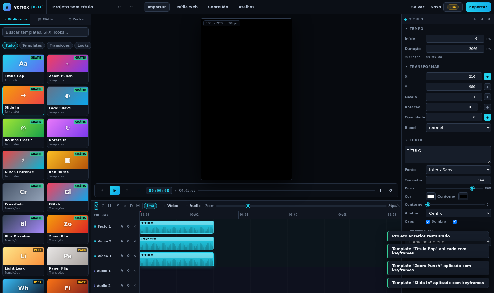

# Vortex — Editor profissional de vídeo, áudio e motion graphics

Editor **não-linear** que roda no navegador, com timeline multi-trilha, keyframes, efeitos em tempo real,
biblioteca de conteúdo integrada e export de vídeo/áudio. Sem instalação, sem upload de mídia, sem marca d'água.

<p align="center">
  
</p>

---

## O que já funciona

| Área | Recurso |
|---|---|
| **Timeline** | multi-trilha (vídeo + áudio), arrastar, aparar (trim nas duas pontas), dividir, duplicar, ripple delete, íma/snapping magnético, zoom (10–400 px/s), marcadores, in/out, régua clicável |
| **Preview** | compositor Canvas em tempo real, 60 fps, safe area, transporte com play/pause/loop, timecode com frames, scrubbing |
| **Transformar** | posição X/Y, escala, rotação, opacidade — **com keyframes por propriedade** |
| **Keyframes** | curvas de easing: linear, easeIn/Out, easeInOut, bounce, elastic, overshoot |
| **Efeitos (14)** | blur, glow, brightness, contrast, saturation, hue, grayscale, sepia, invert, pixelate, RGB split, vignette, grain, sharpen — pilha ordenada por clipe |
| **Texto** | fonte, tamanho, peso, cor, contorno, sombra, espaçamento, caixa alta, alinhamento |
| **Formas** | retângulo e elipse com cor e raio |
| **Áudio** | mixer Web Audio, volume por clipe, mute/solo por trilha, pré-carregamento de buffers |
| **Biblioteca** | 60+ itens em 10 categorias (templates, transições, looks, texto, formas, elementos, SFX, música, overlays, fundos), busca e filtros |
| **Templates** | 8 templates de motion com keyframes prontos (Pop, Zoom Punch, Slide, Fade, Bounce, Spin, Glitch, Ken Burns) |
| **Export** | MP4/WebM + áudio mixado, WAV só áudio, PNG de frame, projeto em JSON; presets Reels/Shorts/YouTube/Quadrado |
| **Extensão** | "Vortex Mídia" (Chrome/Edge MV3): captura imagem/vídeo/áudio de qualquer página e manda para a biblioteca; + importação por link |
| **Projeto** | autosave, undo/redo (60 passos), atalhos completos, importar por arrastar-e-soltar |

---

## Rodar localmente

```bash
npm install
npm run dev          # http://localhost:5173
```

Build de produção:

```bash
npm run build        # gera dist/
npm run preview      # serve o build
npm run typecheck    # checagem de tipos
```

---

## Arquitetura

```
src/
  types.ts               ProjectDoc — modelo canônico (versionado)
  store/
    editor.ts            estado do documento + comandos + undo/redo
    ui.ts                modais, toasts, packs, usuário
  lib/
    renderer.ts          COMPOSITOR (preview e export usam a MESMA função)
    anim.ts              easing e avaliação de keyframes (busca binária)
    fx.ts                catálogo de efeitos + filtros + passes de canvas
    audio.ts             mixer Web Audio + render offline + WAV
    exporter.ts          export de vídeo/áudio/frame/projeto
    storage.ts           contrato dos 3 níveis de armazenamento
  data/
    library.ts           catálogo de conteúdo (só metadados)
  components/            TopBar, Sidebar, Preview, Inspector, Timeline, Modals
supabase/
  migrations/            schema SaaS (perfis, assinaturas, projetos, packs)
  functions/             checkout, stripe-webhook, pack-link
extension/               extensão Chrome/Edge "Vortex Mídia" (MV3) — ver extension/README.md
```

### Princípios que sustentam o projeto

1. **Documento canônico separado do render.** O projeto é um JSON (`ProjectDoc`). Preview e export consomem o mesmo documento → **paridade garantida**.
2. **Motor puro, sem React.** `lib/renderer.ts` e `lib/anim.ts` são TypeScript puro; a UI só emite comandos.
3. **Tudo é dado, nada é especial.** Texto, forma, vídeo, áudio e grupo são "elementos" com `type + transform + effects`. Por isso um template é só JSON.
4. **Command pattern.** Toda mutação passa por `commit()` → undo/redo, colaboração futura e automação por IA saem de graça.
5. **Banco guarda ponteiros, não bytes.** Metadados no Postgres (~2 KB/linha), mídia em object storage ou no disco do usuário.

---

## Modelo de conteúdo: 3 níveis (o segredo do custo baixo)

| Nível | O que é | Onde fica | Custo |
|---|---|---|---|
| **A · Oficial** | 300–500 itens curados e licenciados | R2/B2 + CDN | ≈ US$ 9/mês |
| **B · Packs** | bibliotecas grandes (SFX, música, overlays, fundos) | baixadas sob demanda pelo usuário | **US$ 0** |
| **C · Meus arquivos** | mídia do próprio usuário | pasta dele (File System Access / OPFS) | **US$ 0** |

O banco guarda apenas: `id, hash, nome, tipo, bytes, duração, w, h, fps, tags, storage_key, license_id`.
Com 3.000 assets isso é **~6 MB de banco**. A biblioteca abre instantânea porque a interface carrega só
thumbnails e waveforms (~5% do peso do original).

> Ferramentas de catalogação dos seus packs: veja `../editor-pro/catalogo/` (`censo.mjs`, `derivados.mjs`, `SCHEMA-supabase.sql`).

---

## Atalhos

| Tecla | Ação | Tecla | Ação |
|---|---|---|---|
| `Espaço` / `K` | Play / Pause | `S` | Dividir no playhead |
| `←` `→` | 1 frame | `Shift+←/→` | 1 segundo |
| `V` / `C` / `H` | Seleção / Faca / Mão | `M` | Marcador |
| `I` / `O` | Entrada / Saída | `Del` | Excluir |
| `Ctrl+Z` | Desfazer | `Ctrl+Shift+Z` | Refazer |
| `Ctrl+D` | Duplicar | `Ctrl+S` | Salvar |
| `Ctrl+E` | Exportar | `Ctrl + / -` | Zoom da timeline |

Lista completa no app: botão **Atalhos**.

---

## Publicar / Deploy

### GitHub
| SO | Comando |
|---|---|
| Windows | duplo clique em **`publicar.bat`** |
| Mac/Linux | `bash publicar.sh` |

O script inicializa o repositório, commita e envia para
`https://github.com/editmotiom-art/Vortex_editor` (pede token no lugar da senha).
Guia completo: `editor-pro/PUBLICAR-NO-GITHUB.md`.

### Netlify
1. **Add new site → Import an existing project → GitHub → `Vortex_editor`**
2. Build `npm run build` · Publish `dist` (já configurado no `netlify.toml`)
3. Variáveis: `VITE_SUPABASE_URL`, `VITE_SUPABASE_ANON_KEY`, `VITE_CDN_URL`

## Deploy

### Netlify (recomendado — zero config)

```bash
npm i -g netlify-cli
netlify login
netlify init          # cria o site e conecta ao GitHub
netlify deploy --prod
```

O `netlify.toml` já define build, redirects de SPA e headers de segurança.

### GitHub (código salvo + histórico)

```bash
git init
git add .
git commit -m "feat: Vortex editor v0.1"
git branch -M main
git remote add origin https://github.com/SEU-USUARIO/vortex.git
git push -u origin main
```

Depois de conectar o repositório na Netlify, **todo push publica automático**.

### Supabase (banco + auth + assinaturas)

```bash
npm i -g supabase
supabase login
supabase link --project-ref SEU_PROJECT_REF
supabase db push                                    # aplica as migrations
supabase functions deploy checkout
supabase functions deploy stripe-webhook --no-verify-jwt
supabase functions deploy pack-link
```

Variáveis no front (Netlify → Site settings → Environment):

```
VITE_SUPABASE_URL=https://xxxx.supabase.co
VITE_SUPABASE_ANON_KEY=eyJ...
VITE_CDN_URL=https://cdn.seudominio.com
```

---

## Roadmap

- [x] **0.1** Editor: timeline, preview, keyframes, efeitos, biblioteca, export
- [ ] **0.2** Autenticação (Supabase Auth) + projetos na nuvem + histórico de versões
- [ ] **0.3** Export via **WebCodecs** (H.264 determinístico, 5–10× mais rápido)
- [ ] **0.4** WebGPU como backend do compositor (30+ efeitos, blend modes reais)
- [ ] **0.5** Importador **Alight Motion `.xml`** + relink de mídia + galeria de templates
- [ ] **0.6** Legendas automáticas (STT), corte por silêncio, reframe 9:16
- [x] **0.4b** Extensão de captura de mídia integrada ao editor
- [ ] **1.0** Desktop (Tauri), ProRes, marketplace de templates, colaboração

---

## Licença

Código sob **MIT**. O conteúdo da biblioteca tem licenciamento próprio — ver `supabase/migrations` (tabela `licenses`)
e a regra que bloqueia conteúdo oficial sem licença de redistribuição.
